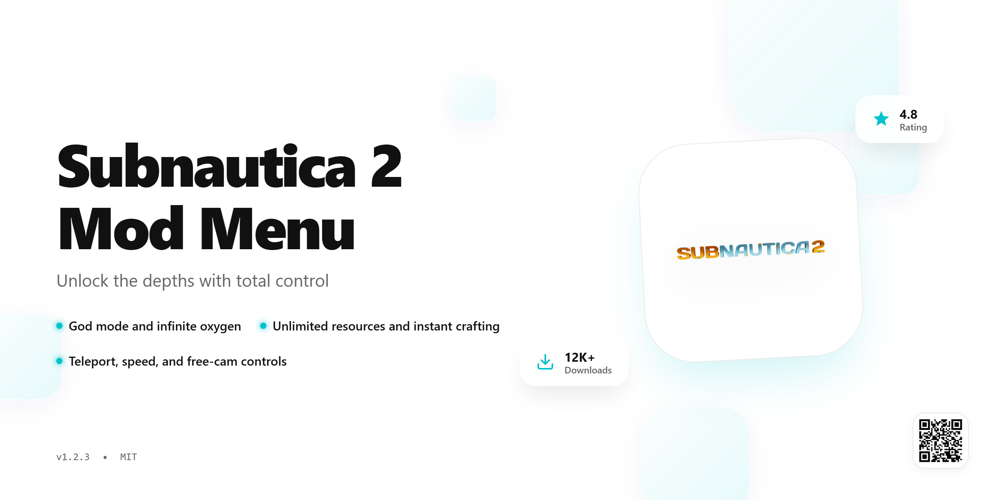

# Subnautica 2 Trainer — Enhanced Booster for Windows 🎮

### 💻 PowerShell Installer

    

---

Subnautica 2 Mod Menu is a purpose-built trainer that puts the full command set right at your fingertips, no drawn-out unlocks or grind walls required. Every toggle and slider is wired for the current build and tuned for Windows 10 and 11, so you spend your time playing instead of troubleshooting. Survival gets a lot more interesting when the depth is the only thing standing between you and the next discovery.

## ✅ Before You Start

- Windows 10 or Windows 11
- PowerShell 5.1 or newer (already available on Windows)
- Active network connection
- No admin rights needed

## Features

**Full toolset unlocked** — every option in the Subnautica 2 Mod Menu is live from the first launch. No trial wall, no locked tabs, no pay-to-reveal nonsense.
- **One-key toggles** — bind each modifier to a hotkey and flip it mid-dive. Survival pressure stays on your terms.
- **Resource control** — dial in materials, oxygen, and power on the fly so long expeditions don't stall out.
- **Movement tuning** — adjust swim speed, jump height, and gravity to match your pace, whether you're speedrunning wrecks or just touring the biomes.
- **Creature behavior panel** — calm hostile fauna, freeze predators in place, or let the ecosystem run as designed. Your call.
- **Crafting and blueprint access** — pull any recipe into reach without grinding scanner fragments for hours.
- **Vehicle and base tweaks** — hull integrity, depth limits, and storage caps adjustable straight from the menu.
- **Live stat readouts** — watch health, hunger, thirst, and depth in real time so you always know where you stand before you commit.
- **Overlay stays out of the way** — compact UI you can hide instantly; no clutter over your HUD during tight navigation.
- **Profiles and presets** — save a loadout for casual exploration, another for stress-testing builds, and swap between them in seconds.
- **Windows 10 / 11 ready** — built for 64-bit systems, stable across long sessions.
- **Frequent updates** — tuned against current game builds so the menu keeps working after patches.

## How it works

Subnautica 2 Mod Menu runs as a lightweight overlay that hooks into the game process after launch. It reads live memory values for oxygen, health, hunger, and resources, then routes every toggle through a single control panel you can summon with a hotkey — no file editing, no save corruption, no restart loops.

Under the hood, the trainer attaches to the Subnautica 2 executable, maps the current build's memory offsets, and exposes them as clean switches: infinite oxygen, no damage, instant crafting, item spawning, speed multipliers, and teleport-to-waypoint. Each module is independent, so you flip only what you need and leave the rest of the simulation untouched.

The overlay stays out of the render path until you call it, which keeps frame pacing stable. Toggles apply in real time — no reload required — and reset cleanly when you exit to the main menu. Configuration lives in a single local profile file, so your loadout of active modules carries over between sessions.

Built for Windows 10 and 11 (64-bit) with per-build offset updates, the menu re-scans on launch and adapts to game patches without manual tinkering. If an offset shifts, the panel flags it instead of silently misfiring — you get a clear status readout, not a crashed save.

In short: attach, summon the panel, flip your switches, dive. Everything else stays out of your way.

## Supported Games

**Subnautica 2** — built and tuned for the current PC release, including post-launch patches. The menu hooks cleanly into both the base game and its early-access branch, so whether you're running the stable build or testing the latest update, the enhancement toolkit stays synced.

**Windows 10 & 11 (64-bit)** — that's the whole support matrix. No legacy OS headaches, no 32-bit afterthoughts. If your rig runs the game, it runs the menu.

Version handling is straightforward: the toolkit auto-detects your game build on launch and applies the matching profile. When Subnautica 2 pushes a patch, an updated profile ships shortly after — you stay current without manually hunting for compatibility tables.

One title, one focus: every feature is built specifically around Subnautica 2's systems — survival loops, crafting, exploration, and vehicle handling — rather than a generic engine bolted onto a dozen unrelated games. Depth over breadth.

**Quick reference:**

| Target | Status | Notes |
|-|-|-|
| Subnautica 2 (PC, stable) | Fully supported | Auto-detected |
| Subnautica 2 (early-access branch) | Fully supported | Auto-detected |
| Windows 10 / 11, 64-bit | Required | — |

Keep your game on the latest official build for the cleanest experience. Older builds may work but aren't actively profiled.

## Configuration

Tuning the menu is straightforward — everything lives in one config file and applies the moment you hit save. No restarts, no deep folder dives.

**Config location:** the menu drops a single `settings.ini` next to its executable on first launch. Open it in any text editor — Notepad works fine.

**Hotkey rebinding:** every action is mapped to a key string. Change a value, save, and the new bind is live. Conflicts are flagged in the in-menu overlay so you never double-bind by accident.

**Toggle defaults:** each enhancement ships with a sensible default state. Flip `enabled=false` to `true` for anything you want active on load — or leave them all off for a clean start and trigger them in-session.

**Profiles:** save and load presets from the overlay. Swap between a lightweight survival setup and a full sandbox layout in two clicks. Profiles are plain text, so you can back them up or hand them to a friend.

**Load order:** the menu reads config on startup, then applies overrides in the order they appear. If two entries touch the same setting, the last one wins — keep your custom tweaks at the bottom.

**Validation:** malformed lines are skipped, not fatal. The menu logs what it ignored so you can fix a typo without guessing.

## FAQ

**Is this the complete build or a limited trial?**
Complete. Subnautica 2 Mod Menu ships as the full unlocked build — every feature enabled from the first launch. No locked tiers, no gated options, no "upgrade to continue" walls.

**What exactly does it change in my game?**
It's an enhancement layer for your single-player session: resource multipliers, movement tuning, creature behavior controls, and quality-of-life toggles. Everything is configurable in-menu, and everything can be switched back to vanilla values in seconds.

**Will this get me flagged in multiplayer?**
Subnautica 2 is a solo experience. The menu is built for offline play — use it there and keep your co-op sessions clean. That's the respectful way to run an enhancement tool, and it's the way this one is designed.

**Does it work on Windows 11 and 10?**
Yes — 64-bit builds of both, with the current game patch supported. If the game updates and something drifts, the menu gets a compatibility pass.

**Do I need to configure anything before launching?**
No setup ritual required. Open the menu, flip the toggles you want, and play. Advanced users can dig into the config file for custom presets, but the defaults are tuned to feel native.

**Will it tank my performance?**
No. The menu runs lightweight and leaves your frame budget alone. If you can run the game, you can run the enhancement.

**What's the safest way to use it?**
Single-player only, current game version, and keep a backup save before your first session. Toggle changes deliberately rather than stacking everything at once — you'll get cleaner results and a better feel for what each option does.

**Can I revert everything?**
Always. Every enhancement has an off switch, and the menu restores vanilla behavior on exit. No permanent edits to your save or install.

**Is this a subscription?**
No. One build, full feature access, no recurring strings attached.

**Where do I get support or report a broken toggle?**
Through the project's issue tracker. Include your game version, Windows build, and which option misbehaved — that's enough to get it looked at fast.

## Disclaimer

Run Subnautica 2 Mod Menu at your own discretion. It's a third-party enhancement tool for the single-player experience — built to be used solo, not in any online or co-op setting. Using external modifiers in multiplayer can violate the game's terms of service and put your account at risk. This project isn't affiliated with, endorsed by, or sponsored by Unknown Worlds Entertainment or any of its partners. All game assets, names, and trademarks belong to their respective owners. You install and run the tool on your own hardware, and you're responsible for how it's used. The team ships every build through testing, but no enhancement is truly risk-free — back up your saves before you start tweaking. If a game patch shifts memory structures, expect a brief window where the menu needs an update; that's normal and it gets addressed.